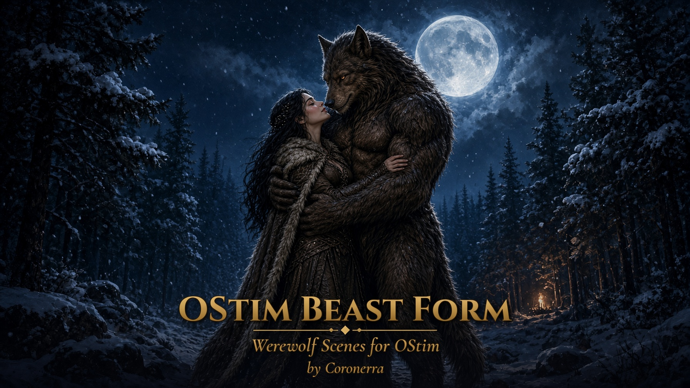

# OStim Beast Form 1.0.1

**Skyrim SE / AE · OStim Standalone · ESL-flagged plugins · FOMOD installer · by That Guy (Coronerra)**

Play as a werewolf, werebear or Vampire Lord in OStim with your mind intact.

> **This is the main OStim Beast Form repository again.** Everything for OStim Beast Form is downloaded from here: the mod, its optional patches, the animation patch for Werewolf and Vampire Lord OStim 0.3.1 and Ostrands with Werewolves.
>
> The older repositories are **superseded by this one** and are no longer updated: [OStim Beast Form Merged](https://github.com/Coronerra/OStim-Beast-Form-Merged), [OStim Beast Form - TWO Edition](https://github.com/Coronerra/OStim-Beast-Form-TWO), [OStim Beast Form Merged - TWO Patch](https://github.com/Coronerra/OStim-Beast-Form-Merged-TWO-Patch) and [OStim Beast Form TWO Herm Patch](https://github.com/Coronerra/OStim-Beast-Form-TWO-Herm-Patch). (The readme and installer inside the 1.0.1 zip still name the Merged repository as the source; this repository replaces it.)

## 📥 Downloads ([v1.0.1 release](https://github.com/Coronerra/OStim-Beast-Form/releases/tag/v1.0.1))

| File | What it is | Who needs it |
|---|---|---|
| `OStim_Beast_Form_1.0.1.zip` | **The mod.** One FOMOD installer for vanilla, TWO and Growl setups. | Everyone |
| `WVL_0.3.1_Patch_0.2.zip` | **Animation patch** for Lirael Atelier's *Werewolf and Vampire Lord OStim v0.3.1*: new menu icons, plus human-first copies of the female werewolf scenes so a human man and a female werewolf can start a scene. **Requires her 0.3.1 pack. Contains no animations.** | Recommended for everyone using her 0.3.1 pack |
| `OStim_Beast_Form_1.0.1_Softbody_Tullius_Patches.zip` | The matching `OCumMaleScript` for GT Softbody and/or Tull Animated Creampie + Liquid Pack. | Only GT Softbody or Tull / Liquid Pack users |
| `OStim_Beast_Form_1.0.1_Herm_Patch.zip` | **Herm / Futa Patch** (A.K.A. Fruta) for TWO Extras' herm / urta **player** werewolf. | Only TWO Extras herm / urta users (TWO or Growl + TWO setups) |
| `Ostrands_with_Werewolves_0.8.0.3.zip` | **OStrands patch**: drop-in OStrands DLL with female werewolf support. GPL v3, [source](https://github.com/Coronerra/Ostrands-with-Werewolves). | Optional, only if you use OStrands |

MD5 checksums are listed in the release notes.

---

## ⚠️ Read first

- **This is not a creature mod.** It treats werewolves and Vampire Lords as a sentient race, the way the game treats Argonians and Khajiit. When you transform, the game changes your race; OStim then has no idea what to do with you. This mod fills that gap.
- **It has no sex animations of its own.** The recommended animation source is Lirael Atelier's **[Werewolf and Vampire Lord OStim v0.3.1](https://www.patreon.com/LiraelAtelier/posts/werewolf-and-for-175434973)** (support her on [Patreon](https://www.patreon.com/LiraelAtelier)). Any OStim pack with werewolf or Vampire Lord scenes also works.
- **OStim Beast Form never edits an animation pack.** It only adds its own start poses, menus and (optionally) couple starts. The separate animation patch is the only download that touches Lirael's pack, and it only replaces scene files for icons and adds new human-first scenes.
- **TWO files are not included.** This mod uses parts of the [TWO - Total Werewolf Overhaul](https://www.loverslab.com/topic/159911-two-total-werewolf-overhaul/) 4.1 body by Frosferes. Frosferes is okay with patches, but files he made that I did not have to patch are not repackaged. Vanilla and Growl players copy those files in themselves (see [TWO Core Files](#two-core-files)).
- **Read every installer page.** If you pick the wrong options, the mod won't work.

## ✨ What you get

- Start-scene hotkey (MCM) while you're a werewolf or werebear, out of combat. The beast timer pauses during scenes.
- Werewolves and Vampire Lords are their own OStim actor types (male and female), so every pack with werewolf or Vampire Lord scenes shows up.
- This mod's own start poses and menus (stage-1 poses by Billyy, with permission). They never replace files from OCreatures Reforged or any animation pack.
- Optional **Beast couples**: two werewolves or two Vampire Lords, using Lirael's couple scenes.
- Vampire Lords can be sex partners when the NPC wants it (SkyrimNet / OStimNet).
- SkyrimNet: NPCs are told when someone transforms, while they're transformed, and when they turn back.
- Big loads (OCum, MCM, on by default) for werewolves and werebears; Beast Pie keeps the OCum / Tull / Liquid creampie through beast form.
- Converted female werewolf body (SMP opening that reacts to TNG and SOS) and converted male cock (SMP collision with UNP / CBBE / UBE bodies).
- BFA expression morphs for werewolf and Vampire Lord heads.
- Growl core: werebears, with MCM "Werebears use werewolf scenes" (on by default).
- **Own log file** for bug reports (new in 1.0.1, see [Troubleshooting](#troubleshooting)).

---

## 📋 Requirements (everyone)

- Skyrim SE / AE, [SKSE](https://skse.silverlock.org/), Address Library for SKSE Plugins, SkyUI, [PapyrusUtil](https://www.nexusmods.com/skyrimspecialedition/mods/13048), powerofthree's Papyrus Extender, XPMSSE, FSMP (Faster HDT-SMP)
- **OStim Standalone** and **OCum Ascended**
- **Pandora** (or your behavior engine), run again after installing
- An OStim pack with werewolf scenes. **Recommended: [Werewolf and Vampire Lord OStim v0.3.1](https://www.patreon.com/LiraelAtelier/posts/werewolf-and-for-175434973) by Lirael Atelier** (pack author; animations by Billyy, Anub, FlufyFox, BakaFactory, FunnyBizness, the More Nasty Critters team and MadMansGun)
- Vampire Lords: Monster Facial Animation (MFA) meshes
- **Optional:** [OCreatures Reforged](https://dwemermods.com/mods/5173) (the installer asks), SkyrimNet, OStimNet, OStrands
- **Not needed / keep off:** HDT Werewolves (its plugin is also called `Werewolves.esp`), ABC, Creature Framework, HCOS, SOS, SexLab

Per setup:

| Setup | Also needs |
|---|---|
| **Vanilla** (core A) | The TWO 4.1 files listed in the `PUT_TWO_FILES_HERE.txt` notes ([TWO Core Files](#two-core-files)). The TWO plugin itself is **not** needed. |
| **TWO** (core B) | TWO 4.1 Core (`Werewolves.esp`) and Monster Facial Animation (`MonsterLipSync1.esp`) |
| **Growl / Nolvus** (core C) | Growl - Werebeasts of Skyrim, JS Emissive Eyes SE, Monster Facial Animation (head meshes), and either the [TWO Core Files](#two-core-files) (Growl only) **or** TWO 4.1 Core with its Growl patch (Growl + TWO) |

---

## 🧹 Before you install: remove old versions

OStim Beast Form 1.0.1 replaces **every** earlier OStim Beast Form download. In MO2, **disable or remove** all of these before you install (keep your save; see [Existing saves](#existing-saves)):

- **OStim Beast Form Merged** (0.5 – 0.8.1)
- **OStim Beast Form - TWO Edition** (0.1 – 0.2)
- **OStim Beast Form Merged - TWO Patch** (0.1)
- **OStim Beast Form TWO Herm Patch** (0.1), or the Hermaphrodite option of Merged 0.8.x (use the new Herm / Futa Patch instead)
- The original **OStim Beast Form** 0.1, and the old Beast Lite, Beast Aware, OCum Beast Pie and BeastForm BFA Heads mods
- **WVL 0.3.1 Icon Patch 0.1** (replaced by WVL 0.3.1 Patch 0.2)
- The separate **OCum-Tull-Liquid-Softbody-Patch** if you install the Softbody / Tullius Patches (same script)
- Coming from 1.0: just install 1.0.1 over it with the same choices (MO2: **Replace**).

---

## 🎛️ What the installer asks

| Page | Question | Choices |
|---|---|---|
| 1 | **Which werewolf setup do you use?** (pick ONE) | **A. Vanilla / FSMP (no TWO, no Growl)** · **B. TWO 4.1 user (no Growl)** · **C. Growl user** (recommended for Nolvus) |
| 2 | **Growl + TWO?** (only shown for C) | **Growl only** or **Growl + TWO 4.1** (adds `OStim_Beast_Form_Merged_TWO_Patch.esp` and its BFA Heads plugin) |
| 3 | **Do you use OCreatures Reforged (`OCreatures.esp`)?** | **Yes** (nothing extra installed; OCR's files are never replaced) or **No** (installs this mod's own werewolf and Vampire Lord start poses under the names other packs look for). Pre-selected from your load order. |
| 4 | **Beast couples (optional)** | Tick only if you have Lirael's Werewolf and Vampire Lord OStim (`WVLAnimObj.esp`). Pre-ticked when it is enabled. |
| 5 | **Read and acknowledge** | Required. |

---

## 🐺 Installation: Vanilla players (core A)

For players with **neither TWO nor Growl** (vanilla werewolves, FSMP).

1. **Remove old versions** (see above).
2. **Install the animation source:** Lirael's Werewolf and Vampire Lord OStim **v0.3.1** with its own installer (or another OStim pack with werewolf scenes). Optional: OCreatures Reforged.
3. **Make the TWO Core Files mod** (see [TWO Core Files](#two-core-files)). Do **not** enable TWO's `Werewolves.esp`.
4. **Install `OStim_Beast_Form_1.0.1.zip`** in MO2:
   - Page 1: **A. Vanilla / FSMP**
   - Page 3: **Yes** if you use OCreatures Reforged, otherwise **No**
   - Page 4: tick **Beast couples** if you installed Lirael's pack
5. **Install the animation patch** `WVL_0.3.1_Patch_0.2.zip` (if you use her 0.3.1 pack): tick the **same** animation packs, animators and male-partner option you chose for 0.3.1.
6. **Optional patches:** Softbody / Tullius Patches if you use GT Softbody or Tull / Liquid Pack; Ostrands with Werewolves if you use OStrands. The Herm / Futa Patch does **not** work with core A (TWO Extras needs TWO's plugin).
7. **MO2 left pane (mods), top to bottom** (see [Load order](#load-order)): OStim, OCum (and GT Softbody / Tull add-on) → OCreatures Reforged (optional) → Werewolf and Vampire Lord OStim 0.3.1 → **WVL 0.3.1 Patch 0.2** → OStrands → Ostrands with Werewolves → **OStim Beast Form 1.0.1** → Softbody / Tullius Patches → **TWO Core Files** (below OCR so TWO's skeleton and body win) → Pandora Output.
8. **Plugins (right pane):** `OStim_Beast_Form_TWO.esp` (core A uses the same plugin name as core B) after `OStim.esp`, `OCum.esp` and `OCreatures.esp`.
9. **Run Pandora** (or your behavior engine), then start the game.

## 🐺 Installation: TWO players (core B)

For players using **TWO - Total Werewolf Overhaul 4.1 without Growl**.

1. **Remove old versions**, especially **OStim Beast Form - TWO Edition**, the **TWO Patch** and the old **TWO Herm Patch**.
2. **Install TWO 4.1** (Core) and **Monster Facial Animation** if you haven't. Keep HDT Werewolves off.
3. **Install the animation source:** Lirael's Werewolf and Vampire Lord OStim **v0.3.1** (optional: OCreatures Reforged).
4. **Install `OStim_Beast_Form_1.0.1.zip`** in MO2:
   - Page 1: **B. TWO 4.1 user (no Growl)**
   - Page 3: **Yes** / **No** for OCreatures Reforged
   - Page 4: tick **Beast couples** if you installed Lirael's pack
   You don't need the TWO Core Files mod: TWO itself provides those files.
5. **Install the animation patch** `WVL_0.3.1_Patch_0.2.zip` (same ticks as your 0.3.1 install).
6. **Optional patches:** Softbody / Tullius Patches; **Herm / Futa Patch** if you play TWO Extras' herm / urta werewolf (needs `WerewolvesExtras.esp`; leave OStim's "Futas use male role" on); Ostrands with Werewolves.
7. **MO2 left pane, top to bottom** (see [Load order](#load-order)): OStim, OCum → OCreatures Reforged → Werewolf and Vampire Lord OStim 0.3.1 → **WVL 0.3.1 Patch 0.2** → OStrands → Ostrands with Werewolves → **OStim Beast Form 1.0.1** → Softbody / Tullius Patches → Herm / Futa Patch → **TWO 4.1** (and TWO Extras, below OCR so TWO's skeleton and body win) → Pandora Output.
8. **Plugins (right pane), in this order:** `MonsterLipSync1.esp` → `OCreatures.esp` (optional) → `Werewolves.esp` (then any other `Werewolves*.esp`) → **`OStim_Beast_Form_TWO.esp`** → **`OStim_Beast_Form_TWO - BFA Heads.esp`** → `OStim_Beast_Form_TWO_Herm_Patch.esp` (herm only). `Werewolves.esp` must load **after** `OCreatures.esp` or TWO's heads go missing; our plugins go after TWO so our race edits win.
9. **Run Pandora**, then start the game.

## 🐺 Installation: Growl (Nolvus) players (core C)

For players using **Growl - Werebeasts of Skyrim** (the Nolvus default). This is the setup it was tested on (Nolvus, Growl only, OCreatures Reforged yes, Beast couples on, Softbody / Tullius Patches).

1. **Remove old versions**, especially **OStim Beast Form Merged 0.8.x**. If you only had TWO installed for the old Merged mod and don't otherwise use it, you can disable TWO 4.1 and use **Growl only**.
2. **Make sure Growl, JS Emissive Eyes SE and Monster Facial Animation are installed** (Nolvus has them). Keep HDT Werewolves off (see [Must be off](#must-be-off)).
3. **Install the animation source:** Lirael's Werewolf and Vampire Lord OStim **v0.3.1** (optional: OCreatures Reforged).
4. **Growl only:** make the **TWO Core Files** mod (see [TWO Core Files](#two-core-files)); TWO's plugin stays off. **Growl + TWO:** install TWO 4.1 Core with its Growl patch instead.
5. **Install `OStim_Beast_Form_1.0.1.zip`** in MO2:
   - Page 1: **C. Growl user**
   - Page 2: **Growl only**, or **Growl + TWO 4.1** if TWO is enabled
   - Page 3: **Yes** / **No** for OCreatures Reforged
   - Page 4: tick **Beast couples** if you installed Lirael's pack
6. **Install the animation patch** `WVL_0.3.1_Patch_0.2.zip` (same ticks as your 0.3.1 install).
7. **Optional patches:** Softbody / Tullius Patches (Nolvus users with GT Softbody / Tull: pick the matching option); **Herm / Futa Patch** only with **Growl + TWO** and TWO Extras (also `WerewolvesExtrasGrowl.esp`); Ostrands with Werewolves.
8. **MO2 left pane, top to bottom** (see [Load order](#load-order)): OStim, OCum (GT Softbody, Tull add-on) → Monster Facial Animation, Growl → OCreatures Reforged → Werewolf and Vampire Lord OStim 0.3.1 → **WVL 0.3.1 Patch 0.2** → OStrands → Ostrands with Werewolves → **OStim Beast Form 1.0.1** → Softbody / Tullius Patches → Herm / Futa Patch → **TWO Core Files** (Growl only) or **TWO 4.1** (Growl + TWO), below OCR → Pandora Output → *(Nolvus: the Paper Maps mods stay at the very bottom)*.
9. **Plugins (right pane):** `Growl - Werebeasts of Skyrim.esp`, `JS Emissive Eyes SE - Johnskyrim.esp`, `MonsterLipSync1.esp`, `OCreatures.esp` (optional), (`Werewolves.esp` for Growl + TWO) → **`OStim_Beast_Form_Merged.esp`** → (Growl + TWO only) **`OStim_Beast_Form_Merged_TWO_Patch.esp`** directly below it, then `OStim_Beast_Form_Merged_TWO_Patch - BFA Heads.esp` → `OStim_Beast_Form_TWO_Herm_Patch.esp` (herm only).
   - **Nolvus: never put any plugin below Paper Maps.** Keep these plugins **above** `FWMF for Fantasy Paper Maps.esp` and the other Paper Map plugins (the last of them is `Nolvus Awakening Paper Map Patch.esp`). Don't run LOOT; place plugins by hand.
10. **Run Pandora**, then start the game.

---

## 📑 Load order

**Left pane (MO2, lower wins file conflicts):**
- OStim Beast Form 1.0.1 ships **no** files that other mods ship (it never edits OCreatures Reforged or any animation pack), so its exact slot is flexible. Keep it below OStim, OCum, OCR and your animation packs.
- **WVL 0.3.1 Patch 0.2 must be below Werewolf and Vampire Lord OStim 0.3.1** (it overwrites some of her scene files).
- **Softbody / Tullius Patches must be below** OCum Ascended, GT - Softbody and the OCum Tull/Liquid add-on (its `OCumMaleScript.pex` must win).
- **Ostrands with Werewolves must be below OStrands** (its DLL must win).
- **TWO 4.1 or your TWO Core Files must be below OCreatures Reforged and ABC**, which ship the werewolf `skeleton.nif` and body files.
- Pandora Output after all of these. **Nolvus: everything stays above the Paper Maps mods** at the bottom.

**Right pane (plugins):**
- Masters first. Our plugins go **after** Growl, `OCreatures.esp`, `Werewolves.esp` and TWO's Growl / Extras patches, so our werewolf race edits load last.
- `Werewolves.esp` after `OCreatures.esp`, or TWO's heads go missing.
- Growl + TWO: `OStim_Beast_Form_Merged_TWO_Patch.esp` directly below `OStim_Beast_Form_Merged.esp`.
- Herm / Futa Patch last of ours.
- **Never enable `OStim_Beast_Form_TWO.esp` and `OStim_Beast_Form_Merged.esp` together.** The installer never installs both.
- **Nolvus: never put a plugin below Paper Maps** (keep ours above `FWMF for Fantasy Paper Maps.esp` and `Nolvus Awakening Paper Map Patch.esp`). Don't run LOOT; place plugins by hand.

**Must be off:**
- **HDT Werewolves** (its plugin is also called `Werewolves.esp`).
- **Animated Beast's Cocks** (its werewolf skeleton, body and textures collide with TWO's).
- Old patches built for HDT Werewolves (for example `MFA-Growl-HDTWW_Patch.esp`).
- **OCum Werewolf Shot** (its urethra node is already in this mod).
- Every older OStim Beast Form download (see [Remove old versions](#before-you-install-remove-old-versions)).

---

## 📦 TWO Core Files (Vanilla and Growl-only players)

The vanilla core (A) and the Growl core (C, Growl only) use TWO's male body, skeleton and textures without TWO's plugin. Those files are Frosferes' and are **not** included. Build your own small mod from the TWO 4.1 download:

1. Download **TWO - Total Werewolf Overhaul 4.1** from [LoversLab](https://www.loverslab.com/topic/159911-two-total-werewolf-overhaul/).
2. In MO2, create an empty mod (for example *OStim Beast Form 1.0 - TWO Core Files*).
3. Copy these files from TWO's **Core** folder into it, keeping the folder paths:
   - `meshes\actors\werewolfbeast\character assets\`: `malebodywerewolf_0.nif`, `malebodywerewolf_1.nif`, `malebodywerewolf.tri`, `skeleton.nif`
   - `textures\actors\character\werewolf\`: every `.dds` (body, head, mouth, with `_n` and `_sk` maps)
   - `textures\actors\character\eyes\`: TWO's `eyewerewolfbeast*.dds`
   - `textures\MoreNastyCritters\werewolf\`: `werewolfballs.dds`, `werewolfballs_n.dds`, `werewolfballs_sk.dds`, `werewolfpenis_red.dds`, `werewolfpenis_n.dds`, `werewolfpenis_sk.dds`
   - **Vanilla (core A) only**, `meshes\actors\werewolfbeast\character assets\HeadParts\`: `MaleHeadWerewolf.nif`, `MaleMouthWerewolf.nif`, `MaleEyesWerewolf.nif`, `FemaleHeadWerewolf.nif`, `FemaleMouthWerewolf.nif`, `FemaleEyesWerewolf.nif`, `ExpMouthWerewolf.tri`, `ExpEyesWerewolf.tri`
4. **Do not copy or enable `Werewolves.esp`.**
5. Place the mod **below OCreatures Reforged** (and below ABC or any other mod that ships a werewolf `skeleton.nif` or body), so TWO's skeleton and body win. Its order relative to OStim Beast Form doesn't matter: they share no files.

The `PUT_..._FILES_HERE.txt` notes inside the installed mod list the same files. The converted female body, the cock and the BFA head expression files **are** included in OStim Beast Form. Growl core users also need werebear meshes from their werebear mod (`PUT_WEREBEAR_FILES_HERE.txt`) and MFA's head meshes (`PUT_MFA_FILES_HERE.txt`); Nolvus already has these.

---

## 🧩 Optional patches

### Animation patch: WVL 0.3.1 Patch 0.2
For Lirael Atelier's **Werewolf and Vampire Lord OStim v0.3.1** (exactly 0.3.1). **Her pack is required; this patch contains no animations, plugins or behavior files.**
- Adds new menu icons in their own folder (`interface/OStim/icons/WVLIcons/`) and points copies of her scene files at them. Shared OStim and OCreatures icons are not overwritten.
- Adds **human-first female werewolf scenes** (cast order [human male, female werewolf]) plus a human-first idle and hub. Without them, starting a scene as a man with a female werewolf can fail with "no valid animations".
- **Install below her 0.3.1 pack** in MO2 so it overwrites. In its installer, tick the same animation packs, animators and male-partner option you chose for 0.3.1 (it tries to pre-tick what it finds; check the ticks).
- **No Pandora run needed** for this patch. Restart the game.
- Replaces WVL 0.3.1 Icon Patch 0.1: remove that first.
- If Lirael updates her pack, this patch has to be rebuilt; don't use it with another version.

### Softbody / Tullius Patches
One file, `Scripts\OCumMaleScript.pex`, picked for your setup (GT Softbody, Tull / Liquid Pack, or both). Put it **below** GT - Softbody, the OCum Tull/Liquid add-on and its Scene Change Fix, and OCum Ascended. Disable the separate OCum-Tull-Liquid-Softbody-Patch (same script). Not needed if you use neither.

### Herm / Futa Patch
Only for TWO Extras' herm / urta **player** werewolf ("Toggle Herm Werewolf"). Works with core B (TWO) or core C with **Growl + TWO 4.1**; **not** with core A. Needs TWO Extras (`WerewolvesExtras.esp`), plus `WerewolvesExtrasGrowl.esp` with Growl. Leave OStim's "Futas use male role" on. Same plugin and scripts as the 0.8.1 Hermaphrodite option, so saves keep working.

> **I am not going to test this myself.** If you use TWO's herm or urta werewolf, please test it and report any problems in the support section of the OStim Beast Form page on LoversLab.

### OStrands patch: Ostrands with Werewolves 0.8.0.3
A drop-in replacement for the OStrands DLL that adds **female werewolf** support. No new build is needed for 1.0.1: every core uses TWO's werewolf skeleton, which has every bone OStrands uses, and female werewolves get TWO's real vagina and anus bones.
- Requires [OStrands](https://www.nexusmods.com/skyrimspecialedition/mods/195115) by LeonVanWinkle (Saint) and its requirements.
- Install it **below OStrands** so its DLL wins (or untick the original and put this in its slot). No plugin, no Pandora run.
- Based on the [OStrands creature support patch](https://www.loverslab.com/files/file/52392-ostrands-creature-support-patch-for-sexlabocreatures) by Keevan2374, with contributions from crajjjj. GNU GPL v3; the license comes in the zip and the full source is at [Coronerra/Ostrands-with-Werewolves](https://github.com/Coronerra/Ostrands-with-Werewolves).

---

## 💾 New game or existing save

- **From 1.0:** install 1.0.1 over it with the same choices. Scripts and docs only; plugins, FormIDs and assets are unchanged.
- **From Merged 0.8.x:** plugin names and FormIDs are the same, so saves keep working. Remove the old version, run the new installer, run Pandora.
- **From Merged 0.8.x with the Hermaphrodite option:** install the Herm / Futa Patch; it is the same plugin and scripts.
- Lirael's role-swap scenes and the menu edits for her pack from 0.8.x are gone; this mod no longer edits any animation pack.
- Changing to a different core on an existing save is not tested.

---

## 🛠️ Troubleshooting

- **Log file:** `Data\SKSE\Plugins\OStimBeastForm.log` (MO2: `overwrite\SKSE\Plugins\OStimBeastForm.log`). Every game load adds a header and a startup block (mods found, race checks, OCR keywords, scene registrations, MCM settings), then one line per event (beast scenes, start-key failures and why, timer pause / resume, climaxes and loads, Beast Pie, aroused-body swaps, Beast Aware, and the patches' lines). MCM > OStim Beast Form > **"Write log file"** (on by default). It starts over after 10 game loads. Needs PapyrusUtil. **If the game crashed, copy the log before you load again.** Attach it to bug reports.
- **Avoid RaceMenu while transformed.** Change back to human form first.
- **"No valid animations" as a human man with a female werewolf:** install the WVL 0.3.1 Patch 0.2.
- **Buttons missing from other packs' menus without OCreatures Reforged:** reinstall and pick **No** on the OCreatures Reforged page so this mod's stand-in start poses are installed. Don't pick **No** if OCR is installed (those files would replace OCR's).
- **Missing heads / bodies:** check the `PUT_..._FILES_HERE.txt` notes and your [TWO Core Files](#two-core-files). On TWO setups, `Werewolves.esp` must load after `OCreatures.esp`.
- **Start poses don't play:** run Pandora again after installing or updating.
- **HDT Werewolves** must be off (its plugin is also called `Werewolves.esp`).
- BodySlide / OBody notes: [docs/BodySlide_OBody.txt](docs/BodySlide_OBody.txt).

---

## 🗂️ What's in this repository

| Path | Contents |
|---|---|
| `package/OStim_Beast_Form_1.0.1/` | The installer tree of the main zip: FOMOD, plugins, compiled scripts and sources, OStim scene and actor JSON, SkyrimNet files, this mod's own / converted meshes |
| `package/Softbody_Tullius_Patches_1.0.1/` | The Softbody / Tullius Patches installer tree |
| `package/Herm_Futa_Patch_1.0.1/` | The Herm / Futa Patch installer tree |
| `patches/WVL_0.3.1_Patch_0.2/` | The WVL 0.3.1 Patch 0.2 installer tree (icons, icon-edited and human-first scene JSON; no animations) |
| `src/` | Papyrus sources for every core and patch, and the SkyrimNet bundles |
| `tools/` | Build, package and check scripts (paths point at the build machine; adjust them) |
| `docs/` | The in-zip readme, BodySlide / OBody notes, animation attribution |
| `CHANGELOG.txt` | Version history (earlier history: [Merged changelog](https://github.com/Coronerra/OStim-Beast-Form-Merged/blob/main/CHANGELOG.md)) |

Only files I made or changed are here. No animation pack files are included, and no TWO files I didn't have to patch.

## 🙏 Credits

- **That Guy (Coronerra):** OStim Beast Form, the patches and Ostrands with Werewolves.
- **Frosferes:** TWO - Total Werewolf Overhaul (the body this mod's converted female werewolf and cock are made from).
- **Billyy:** the werewolf animations behind this mod's start poses (with permission); see [docs/Lite_animation_attribution.txt](docs/Lite_animation_attribution.txt).
- **Lirael Atelier:** Werewolf and Vampire Lord OStim (pack author). Its animations are by Billyy, Anub, FlufyFox, BakaFactory, FunnyBizness, the More Nasty Critters team (Dayelyte, Panicforever) and MadMansGun (Horny Creatures of Skyrim), per the pack's credits.
- **LeonVanWinkle (Saint):** OStrands. **Keevan2374** and **crajjjj:** the OStrands creature fork.
- The authors of Growl - Werebeasts of Skyrim, Monster Facial Animation, OStim, OCum, OCreatures Reforged, SkyrimNet and OStimNet: the mods this one builds on.

## License

MIT for my own work ([LICENSE](LICENSE)). Third-party assets belong to their authors. Ostrands with Werewolves is GPL v3.
