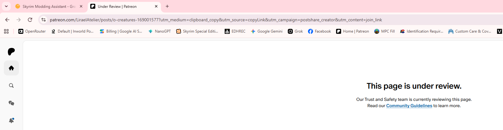

# OStim Beast Form 1.1.1 (final release)

## ⚠️ ABANDONED: Final Release

OStim Beast Form is abandoned as of this release. Lirael's animation pack, which this mod was built around, has been shut down. Beast Form ships no animations of its own, so without that pack it does basically nothing. If her animations are still up anywhere, you can check [dwemermods.com](https://dwemermods.com).



This is a bittersweet one for me. My mod died after a month of hard work. On the other hand, in my view she can't keep collecting money off LoversLab modders' work anymore. From what I saw, she fed other people's mods to her AIs, had them rebuilt her way, and used DLLs that keep people paying to stay in her ecosystem, all without crediting the original mod authors. It's my belief that this mod was used, uncredited, as the basis for OCreatures 1.75 and later. If she comes back, I don't think anyone's mods are safe, so expect her to return with a vengeance.

From here on, it belongs to the community. Build your own animations, make patches, fork it, and do whatever you want with it. If you want to make patches or mods of your own, I suggest:

- [Ultimate Grok Claude Modder Assistant v1.2](https://github.com/Coronerra/Ultimate-Grok-Claude-Modder-Assistant/releases/tag/v1.2)
- [Grok Modders Kit for Skyrim](https://github.com/JezebelGraves/Grok-Modders-Kit-for-Skyrim)

That's what I used to make this mod in the first place, and now I can finally focus on more important things.

Play nice with one another, give credit where it's due and...

**Happy Modding.**

— That Guy (Coronerra)

## Permissions

Anyone may modify, reupload, or build on this mod. Keep the existing permission credits (Billyy, Frosferes, and any other credited authors) in place. This mod is provided as-is, with no further support from the original author.

## What this is

OStim Beast Form is an enabling framework for werewolves, werebears and Vampire Lords in OStim. It starts OStim scenes while you are in beast form, keeps your beast form from running out mid-scene, and works with vanilla, Growl and Total Werewolf Overhaul (TWO).

It ships **no bodies and no sex animations**. It points every body, aroused swap and add-on at the stock vanilla file paths, so any body set drops straight in, and werewolf / Vampire Lord scenes from any OStim animation pack show up through OStim's normal werewolf / vampire lord actor types. Documented hooks (ModEvents, JSON files, path contracts) are for other authors; see `Docs/OStim Beast Form/Extension_Guide.txt`.

## What you need

- OStim Standalone, OCum Ascended, SKSE, Address Library, SkyUI, PapyrusUtil, powerofthree's Papyrus Extender, XPMSSE, FSMP, Pandora.
- **A werewolf / Vampire Lord OStim animation pack (or community-made scenes) for sex scenes.** This mod ships none.
- Vampire Lords: Monster Facial Animation (its meshes).
- Vanilla core: the TWO 4.1 files listed in `PUT_TWO_FILES_HERE.txt` (the TWO plugin itself is not needed).
- TWO core: TWO 4.1 Core and Monster Facial Animation.
- Growl core: Growl, JS Emissive Eyes SE, Monster Facial Animation. Growl + TWO: also TWO 4.1 Core with its Growl patch.
- Optional: RaceMenu (NiOverride) for the size menu; SkyrimNet and OStimNet for the NPC side; OCreatures (original or Reforged).
- Not needed: HDT Werewolves (keep it off), ABC, Creature Framework, HCOS, SOS, SexLab.

## Features

- Start-scene hotkey in werewolf / werebear form, out of combat (default Up Arrow on new games). Optional gesture start key.
- Beast-form timer pauses during scenes; climax can feed the timer (capped).
- Optional combat pause, anatomy size menu (visual only), SkyrimNet / Beast Aware notes, OCum beast loads and Beast Pie.
- Werewolves, werebears (Growl core) and Vampire Lords as their own OStim actor types (male and female).
- Interop with OCreatures: overlapping features step aside, with MCM overrides (Auto / Always ours / Never ours).
- Its own log for bug reports: `Data/SKSE/Plugins/OStimBeastForm.log`.
- Child exclusion on every path that picks an actor (vanilla flag, OStim's check, race name, plus a final sweep). Keep it if you fork.

## Install

1. Install the zip with MO2 and read every installer page.
2. Page 1: pick the one setup you use (Vanilla, TWO, Growl, Growl + TWO).
3. Page 2: tick the extras you want. Beast couples only animate if you still have a couple animation pack that plays them.
4. Page 3 appears only with OCum: pick your OCum script variant.
5. Page 4: read and tick the acknowledgement.
6. Copy the files named in the `PUT_..._FILES_HERE.txt` notes, then run Pandora again.

Enable your OCreatures plugin (if you use one) before installing: the installer decides some files from the plugins that are active at that moment.

## Bodies

Whatever body mod sits at the stock paths is the body you get (`meshes/actors/werewolfbeast/character assets/`, `meshes/actors/dlc02/werebear/`, `meshes/actors/vampirelord/character assets/body/`). Put a body pack below Beast Form, Growl, TWO and Monster Lipsync in the MO2 left pane. Female bodies: two breasts only. See the Extension Guide for the path table, bone names and physics contract.

## OCreatures

Beast Form detects OCreatures by its base plugin, `OCreatures.esp`, so a plain OCreatures install and OCreatures Reforged both count. (A load order with only `OCreatures Reforged - Menu.esp` also counts.) OCreatures is never required. The custom-bodies option and the `bBody=0` ini check are Reforged-only, because only Reforged has that ini.

## Changelog since the last GitHub release (v1.0.2)

The last release uploaded here was v1.0.2. 1.0.3, 1.0.4, 1.0.5 and 1.1.0 were built later and never uploaded, so their changes are listed too.

```
OStim Beast Form 1.1.1 - FINAL RELEASE
This is the last release. The author is stepping away and leaving the mod
with the community: anyone may modify, reupload, fork or build on it, as
long as the existing permission credits (Billyy, Frosferes and any other
credited authors) stay in place. Provided as-is, no further support. See the
notice and permissions at the top of README_OStim_Beast_Form.txt.
Same plugin names and FormIDs as 1.1.0; saves keep working.
- OCreatures detection: Beast Form now looks for OCreatures by its base
  plugin (OCreatures.esp). A plain OCreatures install and OCreatures
  Reforged are both detected, so the start key, beast timer, cum load,
  SkyrimNet state note, size menu and combat pause step aside for either.
  A load order with only the Reforged Menu plugin still counts. No DLL is
  checked. OCreatures is never required. The custom-bodies option and the
  bBody=0 ini check stay Reforged-only, because only Reforged has that ini.
- Final release: NOTICE and PERMISSIONS added. The mod ships no animations
  and no body meshes, so on its own it adds no sex scenes; you need a
  werewolf / Vampire Lord OStim animation pack (or community-made scenes).
- Lirael Atelier's Werewolf and Vampire Lord OStim pack is no longer
  available. It was never required and is not shipped. The optional Beast
  couples start poses were written to play her couple animations if you
  still have the files; without a couple animation pack the buttons will
  not animate. Download links and "recommended" wording removed.
- Version strings now say 1.1.1.

OStim Beast Form 1.1.0
Framework release. Beast Form is an enabling framework: it ships no bodies,
and anyone can make bodies for it. Same plugin names and FormIDs as 1.0.5;
saves keep working. Going back to 1.0.5 is not supported.
- Installer: one page for the four setups (Vanilla / TWO / Growl / Growl +
  TWO), one extras page, an OCum script page that appears only with OCum,
  and the acknowledgement. OCR start-pose stand-ins now install by
  themselves when no OCreatures plugin is active. Credits fixed: this mod
  credits only That Guy (Coronerra).
- Interop: detects OCreatures Reforged and steps aside for the start key,
  beast timer, beast cum load, SkyrimNet state, size menu and combat pause,
  with MCM overrides per duty (Auto / Always ours / Never ours). Other mods
  can claim a duty with the OBF_Claim ModEvent.
- Hooks for other authors: ModEvents (OBF_Ready, OBF_SceneStart/End,
  OBF_TimerPaused/Resumed, OBF_Feed, OBF_SizeChanged, OBF_BodyReport,
  OBF_StateChanged; in: OBF_Claim, OBF_RequestSize, OBF_RequestStart) and
  JSON files (kinds, sizes, directions, arousal). New Extension Guide.
- Safety: every path that picks or adds an actor now runs one child check
  (vanilla flag, OStim's check, race name) and a last sweep over the final
  actor list before OStim is asked to start a scene.
- Icons: 33 icons in Beast Form's own folder, used by its own couples
  scenes; optional icons at the shared paths the Werewolf and Vampire Lord
  scene packs point at.
- Female body: a read-only diagnostic (MCM Body page, log, OBF_BodyReport)
  that reports whether the beast has a female body and breast / genital
  bones. Physics contract, reference configuration and BodySlide notes in
  the docs. "Use Riotguard/custom bodies even with OCR" option (installer
  and MCM) with the one-line OCR setting it needs.
- Combat pause (off by default), climax feeds the beast timer (a few
  minutes per climax, capped), gesture start key (off by default), anatomy
  size menu (off by default, visual size only).
- SkyrimNet: Beast Aware adds size, arousal band and climax count to the
  state note.
- Animation reminder: one message after installing or updating to run
  Pandora or Nemesis.
- MCM: new pages Key, Combat, Feeding, Size, Interop, Body. One MCM script
  for every setup (the Growl werebear toggle shows only with the Growl
  core). MCM version 110: SkyUI rebuilds the pages on 1.0.5 saves.
- OCum script variants (Tull / Liquid Pack, GT Softbody) are now chosen in
  this installer (same scripts as the 1.0.3 patch).
- Version strings now say 1.1.0.

OStim Beast Form 1.0.5
- Bodies: this mod ships NO body meshes any more. Werewolf and werebear
  bodies come from a body set installed at the stock vanilla paths
  (meshes\actors\werewolfbeast\character assets\ and
  meshes\actors\dlc02\werebear\) with the file names vanilla, Growl and
  TWO use. A body set must win over Growl, TWO and Monster Lipsync in
  MO2. Without one, the same paths resolve to TWO / Growl / vanilla, so
  nothing goes missing.
- Plugins: the female werewolf body addon and the aroused werewolf cock
  now point at the stock TWO paths (femalebodywerewolf_1.nif,
  CreatureFramework\CanineRedHard.nif) in every core. These are the same
  paths the 1.0.4 "TWO stock female body" choice used. FormIDs unchanged.
- Installer: the "Female werewolf body" page and the converted softbody
  body, cock, SMP files and BodySlide set are removed.
- Aroused werebear: still MoreNastyCritters\werebear\werebearHard.nif
  (a shared path, not this mod's own); a body set can supply it.
- Kept from 1.0.4: Up Arrow default hotkey, OCum werewolf load, hubs,
  SkyrimNet / Beast Aware fixes.
- Version strings now say 1.0.5.

OStim Beast Form 1.0.4
- Start-scene hotkey now defaults to Up Arrow on new games (it was
  unbound). Existing saves keep their stored key. MCM "reset to default"
  sets Up Arrow; the unmap button still unbinds.
- Fix: Beast Pie could wait forever if a beast-form partner stayed
  unloaded in another cell. The hold now gives up after 30 minutes, or
  after 20 checks (about a minute) with the partner unloaded. Logged.
- Fix: Beast Aware no longer calls SkyrimNet when SkyrimNet is missing or
  the feature is off (no more Papyrus errors on every transform). The 30s
  state refresh only runs while SkyrimNet is present, the mod and "state
  context" are on, and you are in beast form.
- Fix: Beast Aware recognises forms by race form and keyword, not
  English names, and survives a missing race. Werebear (Dragonborn) is
  detected by form. Growl's human-looking Lycanthrope alternate races are
  not treated as beast form.
- Fix: the scene hotkey finds the closest valid NPC in front of you
  (one cell scan, PapyrusUtil) instead of up to 12 random picks. Child
  checks unchanged.
- Fix: the male check in the OStim hook uses the leveled actor base.
- Version strings (log header, script headers) now say 1.0.4.
- Werebear (Growl core): documented the two path families (exploration
  at actors\dlc02\werebear, aroused at MoreNastyCritters\werebear); no
  werebear assets are shipped. Plugins and FormIDs unchanged.
- Source layout: canonical scripts under src/, build script instead of
  committed package trees (see the repo docs).

OStim Beast Form 1.0.3
- The converted female werewolf body (stretchable canal) is now
  buildable in BodySlide: new set "OBF TWO Softbody Female Body"
  (CalienteTools\BodySlide), built from TWO's own "TWO Female Body"
  slider data, output to coronerra\twosoftbody. Added to TWO's "TWO
  Female" group, so TWO presets apply. Ships only this mod's set file,
  group file and modified reference mesh; TWO's BodySlide files are
  needed (not included).
- Installer: "Converted softbody female body" is the default again for
  TWO and Growl + TWO; "TWO stock female body" stays as a fallback.
  Vanilla and Growl-only always use the converted body.
- Plugins, scripts and meshes unchanged from 1.0.2 (same FormIDs).
- Docs: BodySlide steps per setup; human partners need SMP genital
  collision (TNG on 3BA SMP / BHUNP / GT Softbody, or SOS + SMP add-on).
```

## Credits

- That Guy (Coronerra): this mod.
- Frosferes: TWO - Total Werewolf Overhaul (the TWO body and cock standard this mod points at).
- Billyy: the animations this mod ships for its start poses (with permission). See `Docs/OStim Beast Form/Lite_animation_attribution.txt`.
- Lirael Atelier: Werewolf and Vampire Lord OStim (historical credit: the optional Beast couples start poses were written to play her couple animations; not shipped, and the pack is no longer available).
- The authors of Growl - Werebeasts of Skyrim, Monster Facial Animation, OStim, OCum, SkyrimNet and OStimNet: the mods this one builds on.

Existing permission credits must stay in place in any fork or reupload.
